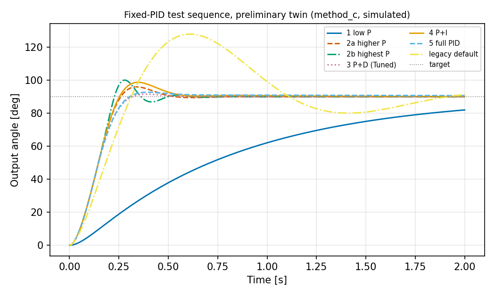
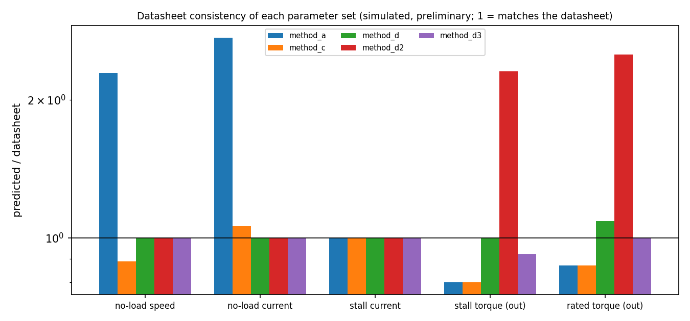
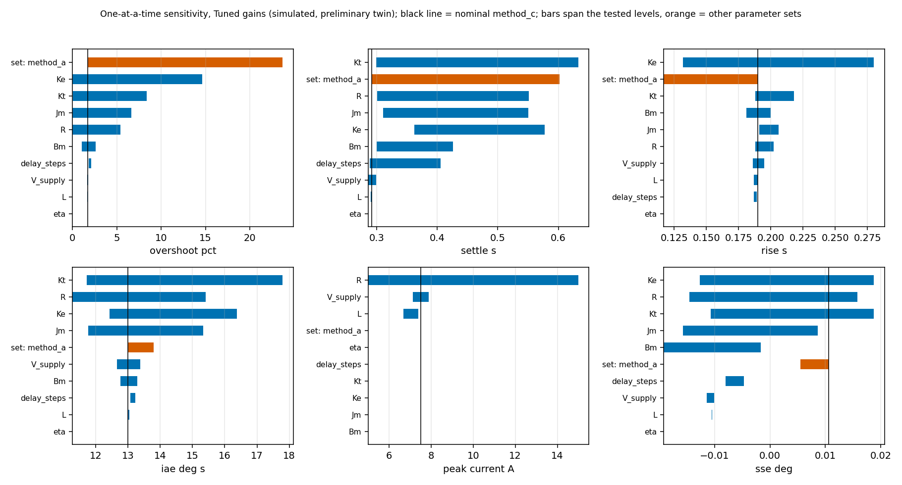

# Digital Twin RL-PID — Robotic Joint

A physics-based digital twin of a single robotic revolute joint — DC motor →
gearbox → joint → encoder → PID — validated first on a low-cost DC geared
motor prototype, with reinforcement-learning-based adaptive PID gain tuning
layered on top once the fixed-gain baseline and digital twin are validated.
Long-term target is an ABB industrial robot arm joint; the prototype motor
validates methodology only.

**Read [`master_prompt_digital_twin_rl_pid.md`](master_prompt_digital_twin_rl_pid.md)
before contributing.** It's the canonical project spec — architecture,
hard engineering rules (§20), and the phase order (§21) that must not be
skipped. This README is an onboarding summary, not a replacement for it.
See [`FILES.md`](FILES.md) for a description of what every tracked file
in the repo actually is and does.

## Software stack

Python 3.x, [Gymnasium](https://gymnasium.farama.org/), NumPy, SciPy,
Pandas, Matplotlib, [PyBullet](https://pybullet.org/),
[Stable-Baselines3](https://stable-baselines3.readthedocs.io/) (+ PyTorch).
Fixed per master prompt §1 — don't swap in MuJoCo/MATLAB/etc. without
justifying it in a PR. CAD→mesh visualization additionally uses trimesh,
cascadio, and pyvista (VTK); its interactive demo's window/controls use
pyvistaqt + PyQt5 — see [Known issues](#known-issues-platform-notes) below
for a PyBullet installation caveat on some platforms.

## Current status

Everything below is a **preliminary** physics-based twin built from datasheet-derived parameters; **nothing has been validated on hardware**, and the RL tuner is a **pre-validation prototype**.

| Phase (master prompt section 21) | Status |
|---|---|
| 1-3 Requirements, datasheet extraction, parameter derivation | Done. Three conflicting derivations are kept and analysed (`docs/parameter_derivation.md`); alternative sets `method_d*` are inactive |
| 4 DC motor ODE | Done (RK4 with automatic sub-stepping for L > 0) |
| 5 Gearbox | Done (ideal; backlash/compliance not modelled) |
| 6 Joint / arm / payload | Done: inertia, gravity, friction, disturbances, optional driver current limit (all OFF by default) |
| 7 Encoder | Done (quantisation, optional noise) |
| 8 Fixed PID | Done (saturation, anti-windup, filtered D) |
| 9 Closed-loop twin | Done, cross-checked across four implementations |
| 10 PyBullet | See `docs/pybullet_install_windows.md`; render-only CAD demos exist |
| 11 Validation | Plan, loader, identification and comparison tooling done (`docs/validation_plan.md`, `validation/`); **no real data yet** |
| 12 Load / disturbance variation | Done in the twin (joint model, sensitivity study) |
| 13-16 Gymnasium env, RL-PID, comparison | See the status notes in `CHANGELOG.md` (pre-validation prototype) |
| 17-18 Sim-to-real prep, real-motor validation | Not started (needs hardware) |

Open datasheet flags (model number, whether 7.5 A is stall current, whether 27.18 kg.cm is a theoretical or practical rating) are listed in [`datasheet/parameter_table.md`](datasheet/parameter_table.md) and decide which parameter set is plausible.

## Quick start

```bash
python -m venv .venv && source .venv/bin/activate        # Windows: .venv\Scripts\activate
pip install -r requirements.txt -r requirements-dev.txt
pytest tests                                              # about a minute
PYTHONPATH=. python simulation/simulate_pid.py            # fixed-PID test sequence -> results/
PYTHONPATH=. python simulation/sensitivity.py --smoke     # sensitivity study (drop --smoke for the full run)
PYTHONPATH=. python simulation/compare_parameter_sets.py  # datasheet consistency of every parameter set
PYTHONPATH=. python simulation/cad_pid_visualizer.py      # 3D demo (needs a display and PyQt5)
python -m http.server --directory autotune_360 8000       # browser twin: http://127.0.0.1:8000/servo_pid_visualizer_360.html
python tools/generate_js_config.py                        # after editing config/motor_parameters.yaml
```

## Bring your own motor

`python -m dtrl motor add --input datasheet.pdf --id my_motor` imports a datasheet (you confirm every value), `motor derive` shows the derived model with intervals and datasheet conflicts, `tune` recommends PID gains for a load (with tier label, uncertainty bands, margins and a report), `export` writes Python/C/Arduino controller code. The browser page has a motor dropdown. Details, tiers and limits: [`docs/motors.md`](docs/motors.md). Every recommendation is labelled **Tier 1 (datasheet estimate, preliminary)** until bench data exists.

## Results (all simulated, preliminary)


*Fixed-PID test sequence on the twin (`results/pid_test_sequence.md`): saturation-limited rise, D damps, I only adds overshoot on a bare shaft.*


*Predicted / datasheet for each parameter set: no set matches every datasheet figure (`docs/parameter_derivation.md`).*


*One-at-a-time sensitivity; Morris ranking says measure Jm, R and Kt first for a bare shaft, and eta, R, Ke for a loaded arm (`results/sensitivity/sensitivity_table.md`).*

## Limitations (read before trusting any number)

- Plant parameters are derived from an incomplete, internally inconsistent datasheet; Jm and Bm are order-of-magnitude placeholders; L is neglected; the gearbox is ideal. The choice between the parameter sets moves bare-shaft overshoot from 0 to 24 percentage points.
- No hardware data exists. "Validated" may be used only for quantities that pass the thresholds in `docs/validation_plan.md` on real data.
- The RL tuner was trained on this unvalidated twin and is a pre-validation prototype.
- The motor validates the **methodology only**; nothing here applies to an industrial (ABB-class) joint.

## Folder structure

```
DigitalTwin_RL_PID/
├── README.md
├── master_prompt_digital_twin_rl_pid.md   # canonical spec — read first
├── requirements.txt
├── data/                  # planned, not created yet
├── datasheet/              # source datasheet PDF + parameter_table.md
├── cad/                    # reference CAD (see caveat below) + converted mesh
├── config/
│   └── motor_parameters.yaml   # all parameters, provenance-tagged, no hard-coding
├── models/                 # dc_motor, gearbox, joint, encoder, digital_twin, units
├── controllers/
│   └── pid.py               # fixed-gain PID: saturation, anti-windup, filtered D
├── simulation/              # phase-by-phase check scripts + demos (see below)
├── pybullet/                # planned, not created yet — Phase 10 proper
├── environments/            # planned, not created yet — Phase 13, Gymnasium env
├── rl/                      # planned, not created yet — Phase 14+
├── validation/              # planned, not created yet — Phase 11
├── results/                 # generated plots/data — gitignored, not source of truth
└── reference/
    └── legacy_demo/          # pid_demo.pdf/.sch/.ino — see note below
```

`cad/` contains the JGB37-520 reference CAD — a **similar but not verified
identical** motor to the project's actual RMCS-3013/3070, used for geometry
reference only (master prompt §3). Don't assume its dimensions/mass without
checking the provenance tags in `datasheet/parameter_table.md`.

`reference/legacy_demo/` holds the original Arduino Pro Mini + L293D +
potentiometer-tuned PID demo board (the YouTube video that inspired this
project). **Historical/conceptual context only** — none of its component
choices, especially the L293D driver, are a spec for this project. The real
motor driver for eventual hardware deployment has not been chosen yet.

## Setup

```bash
git clone <REPO_URL>
cd DigitalTwin_RL_PID
python -m venv .venv
source .venv/bin/activate        # Windows: .venv\Scripts\activate
pip install -r requirements.txt
```

Run from the repo root with it on `PYTHONPATH`:

```bash
PYTHONPATH=. python simulation/simulate_motor.py          # Phase 4 sanity check
PYTHONPATH=. python simulation/interactive_pid_twin.py     # matplotlib sliders, line plots
PYTHONPATH=. python simulation/cad_pid_visualizer.py       # 3D CAD viewer, live PID, presets
```

`interactive_pid_twin.py` and `cad_pid_visualizer.py` also bootstrap the
repo root onto `sys.path` themselves at import time, so you can equally just
open either file in an editor (VS Code's Run button, `F5`, etc.) and run it
directly — no `PYTHONPATH` needed either way. `cad_pid_visualizer.py`
additionally needs a Qt binding installed (`pip install PyQt5`, now in
`requirements.txt`) — `pyvistaqt`/`QtPy` only provide the glue, not a
binding themselves.

### CAD 3D PID demo (`simulation/cad_pid_visualizer.py`)

The most complete demo right now: a real Qt window (pyvistaqt + PyQt5, not
raw pyvista overlay widgets — those had no layout engine and kept
overlapping each other/the 3D view as controls were added) split into a 3D
view on the left, and embedded matplotlib graphs + a controls panel on the
right. The 3D view renders the JGB37-520 CAD (motor housing static, output
shaft + coupler rotating) with a rod+ball **arm** rigidly attached to the
shaft so overshoot/oscillation/damping are actually visible; the camera
re-fits itself to the arm's *current* length every time it changes
(startup included), so it stays framed reasonably tight and the arm can
never be lengthened out of view. The three graphs (angle, error,
control voltage) autoscale to each run's actual data, and the angle graph
carries two live markers: a dot tracking position along the current PID run
(when one is playing), and a dashed line tracking the shaft's actual current
angle at all times (including during the idle spin demo, where there's no
PID run to show a dot for).

The arm's **length and weight are adjustable** (drag the slider or type an
exact value into the box next to it — every control here supports both) and
are not purely cosmetic: both feed extra inertia (reflected through the
gearbox, `m·L²/ratio²`) into the physics, so a heavier/longer arm visibly
slows the PID response. Gravity sag/torque is *not* modeled (the arm's
rotation plane is unspecified) — see the file's docstring for the exact
assumption. Kp/Ki/Kd stay on screen; arm length/weight and the idle
spin-demo speed live under a collapsed **"Arm / spin settings"** panel
(click to expand) so they don't take up space when you're not using them.

Two toggle buttons: **Spin (Demo)** — 0↔180° idle sweep at the slider-set
speed, no physics, starts automatically on launch, and stops cleanly when
unchecked (a real bug in the old overlay-widget version — unchecking it used
to do nothing). **Run PID** — runs the closed-loop twin once using whatever
Kp/Ki/Kd (and current arm length/weight) the controls are set to at click
time, then live-replays it; also stops cleanly if unchecked mid-run, and
re-runs automatically if you nudge a gain or arm slider while it's playing.
Three **presets** (Sluggish / Oscillatory / Tuned) set gains and run
immediately, chosen by grid-searching the model (not guessed) — see the
file's docstring for the exact gains and measured metrics (measured at
default arm settings; they'll drift if the arm sliders are moved far from
default). UI text runs a size larger than Qt's small default (app font,
chart titles/labels/ticks, status readout) for on-screen readability.

## Tests

```bash
pip install -r requirements.txt -r requirements-dev.txt
pytest tests                      # about 1 minute
playwright install chromium       # one-time, ~120 MB; needed only for tests/browser
```

`tools/generate_js_config.py` regenerates the browser config from `config/motor_parameters.yaml` (the single source of truth for motor constants); `tests/test_config_sync.py` fails if it is stale. The Qt demo regression (`tests/gui/`) needs a real display: set `DTRL_QT_GUI=1`.

`tests/test_baseline.py` pins the step-response numbers measured for this twin, so any physics change that moves them fails loudly.
The browser tests (`tests/browser/`) drive `autotune_360/servo_pid_visualizer_360.html` in Chromium via Playwright; if Playwright or its Chromium download is missing they are **skipped, not failed**.

## RL auto-tuner (`autotune_360/`) — pre-validation prototype

A small numpy REINFORCE policy that picks Kp/Ki/Kd for a given payload and target angle. It is trained and evaluated on the preliminary, unvalidated twin only; nothing here is validated on hardware.

**Headline metric: the feasible-only held-out set** (1000 contexts whose torque margin is at least 1.2, so the motor can actually reach the target). Infeasible contexts cannot be solved by any gains, so they are not part of the headline; they are reported separately.

| Controller | Feasible-only (headline): mean cost | within 2 % of target | Full set incl. infeasible (15.3 % of it): mean cost | within 2 % |
|---|---|---|---|---|
| RL auto-tune | **0.539** | **94.7 %** | 1.263 | 80.8 % |
| "Tuned" preset 15/0/0.3 | 0.925 | 72.2 % | 1.632 | 60.8 % |
| Legacy default 5/20/0.05 | 1.712 | 44.9 % | 2.245 | 38.0 % |

Lower cost is better. Source: `autotune_360/autotune_policy_360.meta.json` (seed 0, 300 iterations). Training samples only contexts with margin at least 1.2; contexts with margin in [1.0, 1.2) ("marginal", about 3 % of raw draws) are outside the training distribution and the policy is weaker there (cost 2.66, 46 % within 2 % on a 400-context marginal-band check, versus 4.20 / 1.5 % for the Tuned preset). See `autotune_360/README.md` for regeneration.

## Known issues / platform notes

- **PyBullet**: in the fixed stack (§1) but has no prebuilt wheel for some
  Python/OS combinations (hit on Windows + Python 3.11 during development —
  needs MSVC Build Tools to build from source). If `pip install pybullet`
  fails for you, either install a Python version with a prebuilt wheel, use
  WSL/Linux, or install the build tools. Not required for anything built so
  far — the current CAD demo is render-only (pyvista/VTK), no PyBullet.
- The Ke/Kt/R motor-parameter derivation has a known, documented discrepancy
  between two derivation methods — see `datasheet/parameter_table.md` and
  `simulation/simulate_motor.py`'s output. Not a bug; both are carried
  forward with explicit confidence tags.

## Contributing

See [`CONTRIBUTING.md`](CONTRIBUTING.md) for branching model, commit
conventions, and the PR review checklist (config-driven parameters, no
hardcoding, no fabricated datasheet values, no skipped phases).
