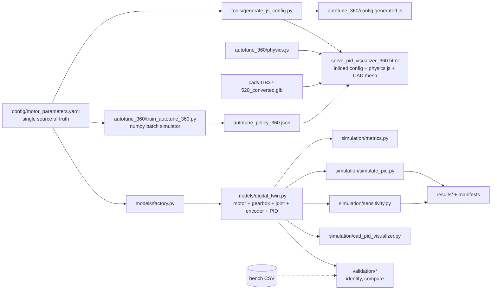
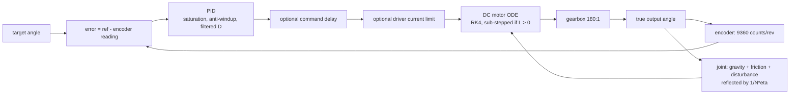

# Architecture

The project is a **preliminary** physics-based digital twin of one geared DC-motor joint plus tuning, sensitivity and validation tooling. This page shows how the pieces connect and where the Python/JavaScript contract lives.

## Data flow

## One control step (models/digital_twin.py)

## The implementations of the plant and how they are kept honest

| Implementation | File | Scope |
|---|---|---|
| Python twin (reference) | `models/`, `controllers/` | everything |
| Trainer batch simulator | `autotune_360/train_autotune_360.py` | payload point mass, gravity, speed cap, current limit, encoder noise; refuses L > 0 |
| Browser physics | `autotune_360/physics.js` | same subset, no noise; refuses L > 0 |
| Qt demo compute path | `simulation/cad_pid_visualizer.py::compute_run` | payload + gravity |

`tests/test_cross_implementation.py` runs the canonical scenarios (`tests/scenarios.json`) through all of them (agreement about 1e-11 deg), `tests/test_base_code_oracle.py` runs the ORIGINAL code from git history as an oracle, and `tests/test_config_sync.py` fails if any motor constant is hard-coded or if the generated JavaScript config, the inlined physics or the embedded mesh is stale.

## Python / JavaScript contract

- Constants: YAML -> `config.generated.js` (regenerate with `python tools/generate_js_config.py`).
- Policy inputs: the 8 features of `features()` in the trainer (`FEATURE_VERSION = 1`) equal `rlFeatures()` in the page (`tests/fixtures/feature_vectors.json`).
- Torque feasibility: `models/feasibility.py` equals `feasibilityJS()` in `physics.js`.
- Policy weights: `autotune_policy_360.json` equals `RL_POLICY` embedded in the page.

## Outputs and provenance

Every script that produces data writes a manifest (`simulation/rawlog.py`): arguments, seeds, commit, config SHA-256, numpy/scipy/python versions, platform and the SHA-256 of each file; raw per-tick logs use one schema (`RAW_COLUMNS`) shared with the bench-data loader (`validation/load_bench_csv.py`). Figures use one fixed colour and line style per method (`simulation/plotstyle.py`).
